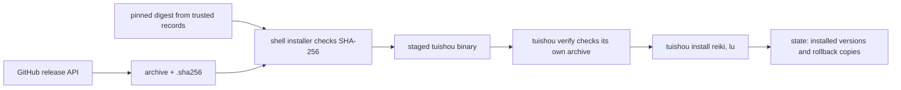

# Tuishou

[](https://github.com/ddproxy/tuishou/actions/workflows/ci.yml)
[](https://github.com/ddproxy/tuishou/releases)
[](LICENSE)

Status: stable for the shell installer on Linux x86_64; this text describes tuishou v0.3.0. Scheduled auto-update is opt-in and off by default.

## What and why

Tuishou installs and updates release artifacts for the Lu stack: `tuishou` itself, `reiki` and `lu`. It downloads from built-in GitHub repositories, checks SHA-256 checksums, verifies GitHub build attestations in process with Sigstore, and records what it installed. No `gh` CLI is used. Component code lives in [ddproxy/reiki](https://github.com/ddproxy/reiki) and [ddproxy/tuishou-lu](https://github.com/ddproxy/tuishou-lu); see [components](docs/components.md).

## Install

One line, without a pinned digest:

```sh
curl -fsSL https://raw.githubusercontent.com/ddproxy/tuishou/main/install.sh | bash -s -- --components reiki,lu
```

Recommended: read the archive digest from an independent trusted channel and pin it. A checksum downloaded from the same release is not a trust bootstrap.

```sh
BOOTSTRAP_SHA256=$(awk '{ print $1; exit }' /etc/tuishou/bootstrap.sha256)
curl -fsSL https://raw.githubusercontent.com/ddproxy/tuishou/main/install.sh | bash -s -- --components reiki,lu --expect-sha256 "$BOOTSTRAP_SHA256"
```

Expected first lines when pinned:

```text
PASS: checksum: PASS (tuishou-<tag>-x86_64-unknown-linux-musl.tar.gz)
PASS: pinned SHA-256: PASS (tuishou-<tag>-x86_64-unknown-linux-musl.tar.gz)
PASS: attestation: PASS (tuishou verify tuishou-<tag>-x86_64-unknown-linux-musl.tar.gz)
## Commands

```sh
# Install a component (latest release, verified in process)
tuishou install reiki
tuishou install lu

# Install a specific version into a prefix
tuishou install lu --version v0.4.0 --prefix /opt/tuishou/bin

# Record an existing binary without replacing it
tuishou adopt lu --version v0.4.0 --prefix /usr/local/bin

# Check every default component (0 none, 10 update available, 1 error, 2 usage)
tuishou update --check

# Update every default component (same as `update all`)
tuishou update

# Inspect an artifact's attestation
tuishou verify reiki-v0.3.0-x86_64-unknown-linux-musl.tar.gz \
  --repo ddproxy/reiki --tag v0.3.0

# Show one fixed-vocabulary status line per component (stable JSON with --json)
tuishou status
tuishou status --json

# Roll back a component to the previous binary
tuishou rollback reiki

# Opt-in scheduled auto-update (off by default, not recommended for production)
tuishou auto-update status --json
tuishou auto-update install-timer --interval 10m

# Update the tuishou binary itself from its own release
tuishou self-update --version v0.2.0

# Host `reiki top` and `lu top` in one terminal (Alt+1/Alt+2 switch, Ctrl+b ? help)
tuishou top
tuishou top --lu-cmd 'lu top --url http://127.0.0.1:8080'

# Print shell completions or the man page
tuishou completions bash
tuishou man
```

The installer checks a pinned digest before extracting anything, then checks the release `.sha256` as a secondary consistency check. Attestation runs only after the binary is installed, using that binary as the verifier, so in-process attestation cannot verify the verifier itself. A pinned digest that does not match exits 4 before extraction. The installer never calls `sudo`; if the prefix is not writable it prints the exact command to rerun as root. See [install](docs/install.md) and [security](docs/security.md).

### Bootstrap trust

Before `tuishou` exists, the only trustworthy digest is one obtained out of band: your release records, a signed note, or a configuration-management record. Put that record outside the GitHub release and its assets. Pass it as `--expect-sha256` (64 hex characters, case-insensitive). Mandatory pinned digests and signed packages are a residual design decision, not implemented in this build; the one-line install still works without `--expect-sha256`.

To inspect before running:
`--allow-unattested` is an explicit local opt-in that warns and continues when verification fails. Auto-update refuses it.

`tuishou top` hosts both component TUIs without reloading them. The `top` feature is on by default in release builds; minimal builds can drop it with `cargo build --no-default-features --locked`. See [top.md](docs/top.md) for keys, command overrides, state and shutdown behaviour.

## Documentation

- [Components](docs/components.md)
- [Hosted TUIs](docs/top.md)
- [Quick start](docs/quick-start.md)
- [Install and update](docs/install-update.md)
- [Node update procedure](docs/node-update.md)
- [Verify a tuishou release](docs/verify-release.md)
- [Scheduled auto-update (opt-in)](docs/auto-update.md)
- [Dogfooding / adoption](docs/dogfooding.md)
- [Security](docs/security.md)
- [FAQ](docs/faq.md)

## Development

```sh
curl -fsSLO https://raw.githubusercontent.com/ddproxy/tuishou/main/install.sh
less install.sh
bash install.sh --help
bash install.sh --components reiki,lu
```

Manual alternative: read the digest from an independent trusted record, download the release archive, write a local checksum file from the pinned digest, and run `sha256sum -c` **before** extraction. Do not rely on the `.sha256` asset from the same release as a trust bootstrap.

```sh
TAG=<tag>
TARGET=x86_64-unknown-linux-musl
ARCHIVE="tuishou-${TAG}-${TARGET}.tar.gz"
BOOTSTRAP_SHA256=$(awk '{ print $1; exit }' /etc/tuishou/bootstrap.sha256)
printf '%s  %s\n' "$BOOTSTRAP_SHA256" "$ARCHIVE" > bootstrap.sha256
curl -fsSLO "https://github.com/ddproxy/tuishou/releases/download/${TAG}/${ARCHIVE}"
sha256sum -c bootstrap.sha256
tar -xzf "$ARCHIVE" tuishou
./tuishou verify "$ARCHIVE" --repo ddproxy/tuishou --tag "$TAG"
install -m 0755 tuishou "$HOME/.local/bin/tuishou"
```

The manual path executes no release code until after the pinned digest passes; it does not check the attestation until `tuishou verify` runs.

## Quickstart (10 minutes)

1. Install and verify the stack. Runs as a normal user install into `~/.local`; root installs into `/usr/local`, which is already on `PATH`. Obtain the archive digest from your independent trusted records first; a digest from the release itself is not a trust bootstrap.

   ```sh
   if [[ -n ${BOOTSTRAP_SHA256:-} ]]; then
     curl -fsSL https://raw.githubusercontent.com/ddproxy/tuishou/main/install.sh | bash -s -- --components reiki,lu --expect-sha256 "$BOOTSTRAP_SHA256"
   else
     printf 'WARN: no pinned bootstrap digest; set BOOTSTRAP_SHA256 from trusted records\n'
     curl -fsSL https://raw.githubusercontent.com/ddproxy/tuishou/main/install.sh | bash -s -- --components reiki,lu
   fi
   # expect: PASS: attestation: PASS (tuishou verify
   ```

2. Put the user install on `PATH` (skip when the installer used `/usr/local/bin`).

   ```sh
   export PATH="$HOME/.local/bin:$PATH"
   ```

3. Proof: show one fixed-vocabulary line per component. `tuishou status` reads local state and checks the APIs; it is the checkable result of this guide.

   ```sh
   tuishou status
   # expect: reiki: up to date (
   ```

   Expected shape, with real versions and timestamps:

   ```text
   reiki: up to date (v<tag>) | auto_update=false installed=v<tag> latest=v<tag> last_check=never last_result=never bad=-
   lu: up to date (v<tag>) | auto_update=false installed=v<tag> latest=v<tag> last_check=never last_result=never bad=-
   tuishou: up to date (v<tag>) | auto_update=false installed=v<tag> latest=v<tag> last_check=never last_result=never bad=-
   ```

## How it works



The installer resolves the latest stable tag (or `--version`), downloads the archive into a private temporary directory under the prefix, checks the out-of-band pinned digest when supplied, then checks the release `.sha256` as a consistency check. Only after those checks does it extract `tuishou`, stage it with a rename, keep `<name>.prev` for rollback, and call `tuishou verify` and `tuishou install`. Components are verified again inside `tuishou install`. Details: [architecture](docs/architecture.md).

## Configuration

`tuishou` reads `./tuishou.toml` by default; `--config <path>` or `TUISHOU_CONFIG` overrides it. Unknown keys and group/world-writable config files are rejected. Installer flags are described in [install](docs/install.md); CLI flags and environment variables are in [cli](docs/cli.md).

| Key | Default | Meaning |
| --- | --- | --- |
| `[auto_update] enabled` | `false` | No scheduled update runs until this is true. |
| `prefix` | unset | Install root for binaries, state and verify cache; CLI `--prefix` wins. |
| `interval` | `10m` | Timer interval; minimum `5m`. |
| `components` | `reiki, lu, tuishou` | Components considered by auto-update; `[[component]] auto_update` still opts each one in. |
| `policy` | `patch` | Version boundary: `patch`, `minor` or `any`. |
| `channel` | `stable` | Stable releases only; `release` is a legacy alias. |
| `min_release_age` | `10m` | Delay before a new release is eligible. |
| `require_attestation` | `true` | Always true; `false` is a config error. |
| `controller_policy` | `manual` | `manual`, `when_idle` or `window`; non-manual requires `backup_dir`. |
| `backup_dir`, `backup_keep` | unset, `5` | Controller database backup location and retention. |
| `reiki_health_url` | `http://127.0.0.1:8080/health` | Health endpoint checked after a Reiki restart. |
| `drain_timeout`, `health_timeout`, `command_timeout` | `30m`, `5m`, `30s` | Update and child-process deadlines. |
| `verify.signer_workflow` | `.github/workflows/release.yml` | Expected attestation signer identity. |
| `verify.cache_ttl` | `24h` | Trusted-root cache lifetime before TUF refresh. |

Minimal example (valid):

```toml
[auto_update]
enabled = true
```

Full example (valid):

```toml
[auto_update]
enabled = true
prefix = "/usr/local/bin"
interval = "10m"
components = ["reiki", "lu", "tuishou"]
policy = "patch"
min_release_age = "10m"
channel = "stable"
max_version = "v9.9.9"
require_attestation = true
controller_policy = "manual"
backup_keep = 5
drain_timeout = "30m"
controller_wait_timeout = "30m"
health_timeout = "5m"
heartbeat_max_age = "5m"
command_timeout = "30s"
agent_unit = "ting.service"
controller_unit = "lu-controller.service"
reiki_health_url = "http://127.0.0.1:8080/health"
notify_after_failures = 3

[update]
start_delay_max = "0"

[verify]
signer_workflow = ".github/workflows/release.yml"
trust_root = "embedded"
cache_ttl = "24h"
```

The full reference is [configuration](docs/configuration.md).

## Operating it

| Task | Command | Note |
| --- | --- | --- |
| Check for updates | `tuishou update --check` | Exit 10 means updates exist, 1 means a failed check. |
| Update components | `tuishou update` | Updates installed components; explicit `tuishou update reiki` can install a missing one. |
| Roll back | `tuishou rollback reiki` | Restores `<name>.prev`. The installer keeps `tuishou.prev` for the same purpose. |
| Inspect attestations | `tuishou verify <archive> --repo ddproxy/tuishou --tag <tag>` | Uses the in-process Sigstore verifier. |
| Auto-update status | `tuishou auto-update status --json` | Reports last check, holds and bad versions. |
| Logs | `journalctl -u reiki.service` | Structured `tuishou:` lines are emitted on stderr and captured by systemd. |

To enable auto-update: set `[auto_update] enabled = true` in `tuishou.toml`, print the units with `tuishou auto-update install-timer --interval 10m`, then install those units on the host. `install-timer` prints units; it does not write or enable them. Auto-update is fail-closed on attestation and is not recommended for production. See [operations](docs/operations.md) and [auto-update](docs/auto-update.md).

## Security model

What verification covers: a pinned digest obtained out of band ties the downloaded archive to independent trusted records; the release `.sha256` is a secondary consistency check; `tuishou verify` checks the GitHub Actions issuer, signer workflow path, tag ref, Rekor inclusion and (on install) the release source repository, ref and commit digest. Component installs fail closed on attestation unless `--allow-unattested` is explicitly passed, which never affects checksums. Auto-update refuses that flag.

What it does not cover: the shell bootstrap runs the downloaded binary's `verify` command before the attestation result is known, so in-process attestation cannot verify the verifier. A `.sha256` asset downloaded with the release is not a trust bootstrap. Pinning is optional in this build; mandatory pinned digests and signed packages remain a residual design decision. Verification does not make a compromised GitHub account, workflow or dependency safe, and it is not a sandbox. No token is printed; `GITHUB_TOKEN` and `GH_TOKEN` are sent only to GitHub API hosts and redacted from errors. See [security](docs/security.md) and [SECURITY.md](SECURITY.md).

## Compatibility matrix

| Layer | Target or client | Last checked |
| --- | --- | --- |
| Shell installer | Linux x86_64, `x86_64-unknown-linux-musl` | v0.3.0, 2026-11-22 |
| Shell installer | Linux aarch64, macOS, other platforms | unsupported; manual install only |
| tuishou binary | `x86_64-unknown-linux-musl` (verified target) | v0.3.0, 2026-11-22 |
| tuishou binary | `aarch64-unknown-linux-musl` (verified target, built only with a cross-linker) | code path, 2026-11-22 |
| tuishou binary | `x86_64-apple-darwin`, `aarch64-apple-darwin` (listed, unverified, not built by the release workflow) | code path, 2026-11-22 |
| Components | `reiki` from `ddproxy/reiki`, `lu` from `ddproxy/tuishou-lu` | asset naming checked against source, 2026-11-22 |
| Test harness | bash, curl, tar, sha256sum, perl or python3 | installer test, 2026-11-22 |

## Limits and non-goals

- The installer targets Linux x86_64 only. It prints the existing release targets and exits 3 elsewhere.
- It never invokes `sudo`, does not install system services, and does not manage component configuration or databases.
- Only one rollback copy per binary is kept; it is not a backup system.
- `tuishou top` does not exist in this build. The installer prints it as a planned command in its next-steps block; do not automate it.
- Attestation needs API access and is not cached offline by the installer. Normal release binaries ignore the test-only loopback and fake-verifier hooks.
- Auto-update is opt-in, stable-only, and not recommended for production. Prerelease channels are rejected.
- Containers, source builds, Windows and macOS installers are out of scope. See [limits](docs/limits.md).

## FAQ

Q: Why does the installer print `bootstrap: only the checksum can be checked before tuishou exists`?
A: Attestation verification needs the verifier binary, so it runs immediately after installation; failure removes the binary. Supply `--expect-sha256` with a digest from an independent trusted channel to make the pre-extraction check meaningful. A checksum downloaded with the release proves consistency, not trust.

Q: Can I install without components?
A: Yes: `bash install.sh --no-components`. `tuishou` is always installed.

More questions: [faq](docs/faq.md).

## Contributing and development

```sh
make help
make build
make test
make lint
make docs-check
make release-check
```

`make test` runs workflow validation, the fake-server installer test and the Rust suite. `make docs-check` executes every quickstart command in a throwaway directory, validates both config examples with the real validator, and checks links, style and flag drift. CI runs the same checks. Tagged `v*` releases are built and attested by the release workflow. Commit messages are terse and imperative, without personal names. See [AGENTS.md](AGENTS.md).

## License and links

[MIT](LICENSE). Documentation index: [docs/README.md](docs/README.md), [llms.txt](llms.txt). Changelog: [CHANGELOG.md](CHANGELOG.md). CLI reference: [docs/cli.md](docs/cli.md). Troubleshooting: [docs/troubleshooting.md](docs/troubleshooting.md).
